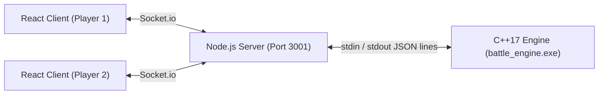
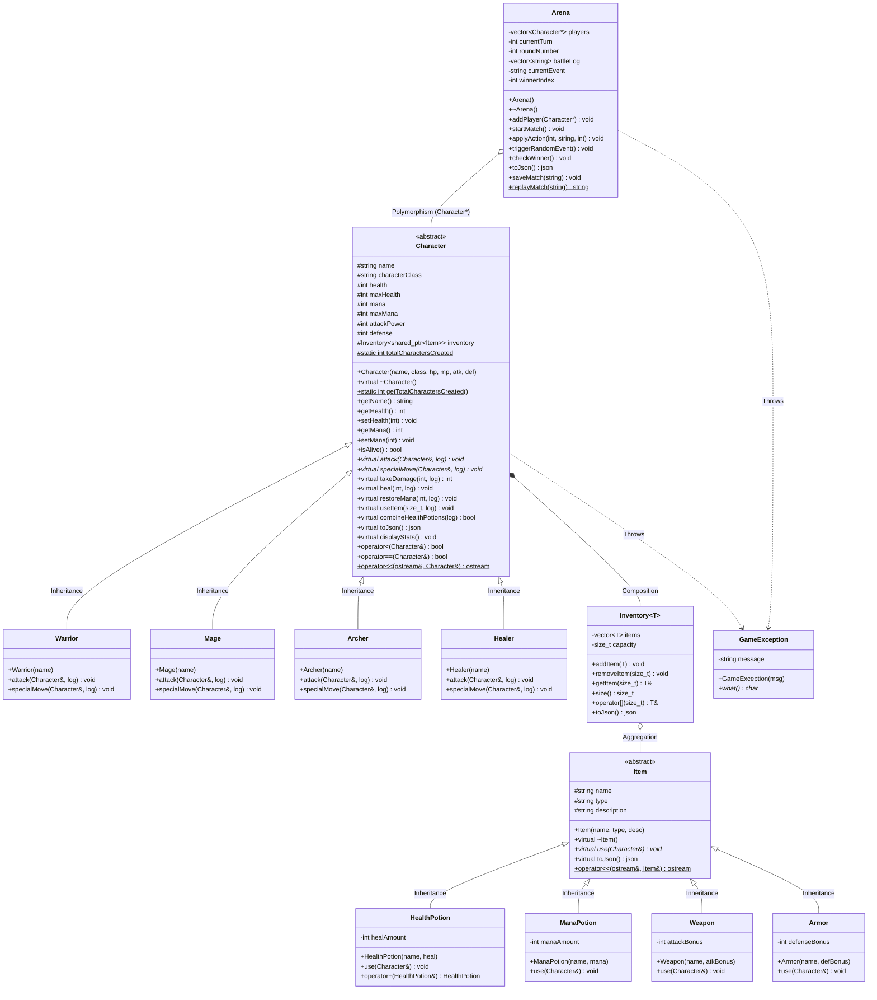

# ⚔️ Battle Arena - C++ OOP Showcase

A full-stack, two-player turn-based battle arena developed for a college **Object-Oriented Programming (C++)** project presentation.

> **Architecture Principle:** ALL game logic, combat equations, turns, validations, item effects, and victory conditions live exclusively inside the compiled **C++17 engine**. The Node.js server and React frontend act strictly as a thin IPC relay and visual presentation layer.

---

## 🏛️ System Architecture



- **C++ Engine (`engine/`)**: High-performance, object-oriented engine compiled with C++17. Implements all 8 required OOP concepts.
- **Node Relay Server (`server/`)**: Express + Socket.io relay. Zero game logic. Spawns `battle_engine.exe` per match and streams JSON lines.
- **React Frontend (`client/`)**: Modern dark-themed fantasy UI with animated health/mana meters, hit animations, combat console, and inventory management.

---

## 📊 UML Class Diagram



---

## 🎯 OOP Concepts Implementation Map

| OOP Concept | C++ File / Location | Academic Explanation & Code Usage |
| :--- | :--- | :--- |
| **1. Abstraction** | [`Character.hpp`](file:///engine/include/Character.hpp), [`Item.hpp`](file:///engine/include/Item.hpp) | Base classes define pure virtual functions (`= 0`) such as `attack()`, `specialMove()`, and `use()`. They cannot be instantiated directly and define an interface contract. |
| **2. Encapsulation** | [`Character.hpp`](file:///engine/include/Character.hpp), [`Character.cpp`](file:///engine/src/Character.cpp) | Core combat attributes (`health`, `mana`, `inventory`) are `protected`/`private`. Mutators enforce boundary constraints (e.g. `setHealth` clamps between `0` and `maxHealth`). |
| **3. Inheritance** | [`Warrior.hpp`](file:///engine/include/Warrior.hpp), [`Mage.hpp`](file:///engine/include/Mage.hpp), [`Archer.hpp`](file:///engine/include/Archer.hpp), [`Healer.hpp`](file:///engine/include/Healer.hpp) | Concrete character archetypes inherit common stats and methods from `Character`, adding unique stat profiles and starter gear. |
| **4. Polymorphism** | [`Arena.hpp`](file:///engine/include/Arena.hpp), [`Arena.cpp`](file:///engine/src/Arena.cpp) | The `Arena` manages fighters polymorphically using `std::vector<Character*>`. Dynamic dispatch resolves `actor.attack()` and `actor.specialMove()` at runtime. |
| **5. Operator Overloading** | [`Item.hpp`](file:///engine/include/Item.hpp), [`Character.hpp`](file:///engine/include/Character.hpp), [`Inventory.hpp`](file:///engine/include/Inventory.hpp) | • `HealthPotion + HealthPotion`: Merges two potions into a `Super Health Potion`<br>• `operator<<`: Formatted stream printing for characters & items<br>• `operator<` & `operator==`: Compares characters by health<br>• `operator[]`: Subscript access for `Inventory<T>`. |
| **6. Templates** | [`Inventory.hpp`](file:///engine/include/Inventory.hpp) | Generic container class `Inventory<T>` managing items or pointers with bounds checking and JSON serialization. |
| **7. Static Members** | [`Character.hpp`](file:///engine/include/Character.hpp), [`Character.cpp`](file:///engine/src/Character.cpp) | `Character::totalCharactersCreated` counts cumulative character instances across the application lifetime. |
| **8. Custom Exceptions** | [`GameException.hpp`](file:///engine/include/GameException.hpp) | Inherits from `std::exception`. Thrown for illegal moves (out of turn, insufficient mana, dead combatant) and caught in a safe `try-catch` boundary. |
| **9. File Handling** | [`Arena.cpp`](file:///engine/src/Arena.cpp) | Uses `std::ofstream` to write match reports to `match_history.txt`, and `std::ifstream` for match replaying. |

---

## 🚀 Setup & Run Instructions

### Prerequisites
- **C++ Compiler**: `g++` (MinGW-w64 on Windows, or GCC/Clang on Linux/macOS) supporting C++17.
- **Node.js**: v18+ with `npm`.

---

### Step 1: Build the C++ Engine

Navigate into `engine/` and compile the engine:

#### On Windows (MinGW):
```bash
cd engine
g++ -std=c++17 -Wall -Wextra -O2 -Iinclude src/*.cpp -o battle_engine.exe
```

#### On Linux / macOS:
```bash
cd engine
g++ -std=c++17 -Wall -Wextra -O2 -Iinclude src/*.cpp -o battle_engine
```

*(Alternatively, use `make` or `cmake -B build && cmake --build build`)*

---

### Step 2: Test the Fallback Console Mode (Terminal Game)

The engine includes a full standalone terminal mode for offline presentations:

```bash
# Windows
.\battle_engine.exe --console

# Linux / macOS
./battle_engine --console
```
You can play a complete match directly in your terminal, compare health via `operator<`, combine potions with `operator+`, and view the replay file!

---

### Step 3: Install and Run the Node Relay Server

Open a terminal and start the server:

```bash
cd server
npm install
npm start
```
The server will start on port `3001` and output:
```
============================================================
BATTLE ARENA RELAY SERVER RUNNING ON PORT 3001
Localhost: http://localhost:3001
LAN (Wi-Fi) IP: http://192.168.x.x:3001
C++ Engine Binary Target: .../battle_engine.exe
============================================================
```

> **Automated Test:** Run `npm test` inside `server/` to run an automated Socket + C++ engine integration test verifying room creation, turn flow, special moves, operator overloading, and match logging!

---

### Step 4: Install and Run the React Client

Open a second terminal and start the Vite client:

```bash
cd client
npm install
npm run dev
```
The client will start at `http://localhost:5173`.

---

## 📱 How to Play from Two Devices on the Same Wi-Fi

1. **Find Host IP**: Note down the LAN IP logged by the Node server (e.g. `http://192.168.105.68:3001`).
2. **Device 1 (Laptop / Host)**:
   - Open browser to `http://localhost:5173`.
   - Enter your name and click **Create New Room**.
   - Note the 4-letter Room Code (e.g., `WARR`).
3. **Device 2 (Phone, Tablet, or Second Laptop)**:
   - Connect to the same Wi-Fi network.
   - Open browser to `http://<HOST_IP>:5173` (e.g., `http://192.168.105.68:5173`).
   - If needed, click *"Configure Server Address"* on the home screen and ensure it points to `http://<HOST_IP>:3001`.
   - Enter your name, input the 4-letter Room Code, and click **Join Room**.
4. **Select Archetypes & Fight!**
   - Both players select their class (**Warrior**, **Mage**, **Archer**, or **Healer**) and click **Lock In**.
   - The Node server automatically spawns the C++ engine executable and starts the match.
   - Players take turns attacking, casting specials, consuming inventory items, or combining health potions!

---

## 📜 JSON IPC Protocol Reference

Communication over `stdin` / `stdout` between Node.js and the C++ Engine is strictly one JSON line per message with flushed standard output:

### Commands (stdin to C++):
```json
{"cmd":"start","players":[{"name":"Arthur","class":"Warrior"},{"name":"Merlin","class":"Mage"}]}
{"cmd":"action","player":0,"action":"attack","itemIndex":0}
{"cmd":"action","player":1,"action":"special","itemIndex":0}
{"cmd":"action","player":0,"action":"combine","itemIndex":0}
{"cmd":"save"}
{"cmd":"state"}
```

### Responses (stdout from C++):
```json
{
  "ok": true,
  "state": {
    "turn": 1,
    "round": 2,
    "players": [
      {
        "name": "Arthur",
        "class": "Warrior",
        "health": 114,
        "maxHealth": 130,
        "mana": 30,
        "maxMana": 30,
        "attackPower": 22,
        "defense": 12,
        "inventory": [...]
      },
      ...
    ],
    "log": ["..."],
    "event": "🌟 Celestial Blessing descends! Both champions restore 15 HP and 10 MP!",
    "winner": null
  }
}
```

If an invalid action is requested (e.g., not enough mana or acting out of turn):
```json
{
  "ok": false,
  "error": "Not enough mana for Fireball! Required: 30 MP, Available: 10 MP."
}
```

---

## 📁 Repository Structure

```
battle-arena/
├── engine/
│   ├── include/
│   │   ├── nlohmann/json.hpp   # Single-header JSON library
│   │   ├── GameException.hpp   # Custom exception class
│   │   ├── Item.hpp            # Abstract Item base and derived items
│   │   ├── Inventory.hpp       # Generic template Inventory<T>
│   │   ├── Character.hpp       # Abstract Character base class
│   │   ├── Warrior.hpp         # Derived Warrior class
│   │   ├── Mage.hpp            # Derived Mage class
│   │   ├── Archer.hpp          # Derived Archer class
│   │   ├── Healer.hpp          # Derived Healer class
│   │   └── Arena.hpp           # Polymorphic Arena and match orchestration
│   ├── src/
│   │   ├── Item.cpp            # Item implementations + operator+
│   │   ├── Character.cpp       # Character implementations + operator overloads
│   │   ├── Warrior.cpp         # Warrior combat methods
│   │   ├── Mage.cpp            # Mage spell mechanics
│   │   ├── Archer.cpp          # Archer critical strikes & multi-shot
│   │   ├── Healer.cpp          # Healer divine siphoning
│   │   ├── Arena.cpp           # Turn rotation, random events, file persistence
│   │   └── main.cpp            # Console (--console) & JSON line IPC modes
│   ├── CMakeLists.txt
│   ├── Makefile
│   └── README.md
├── server/
│   ├── server.js               # Node.js + Express + Socket.io relay
│   ├── test_e2e.js             # Automated integration test script
│   └── package.json
├── client/
│   ├── src/
│   │   ├── components/
│   │   │   ├── HomeScreen.jsx  # Room creation / join screen
│   │   │   ├── SelectScreen.jsx# Character class picker
│   │   │   ├── BattleScreen.jsx# Arena UI, HP/MP bars, combat console, log
│   │   │   └── ItemModal.jsx   # Inventory browser & potion combination
│   │   ├── App.jsx             # Top-level state and Socket.io manager
│   │   ├── index.css           # Game styling, glassmorphism, animations
│   │   └── main.jsx
│   ├── index.html
│   ├── vite.config.js
│   └── package.json
└── README.md
```
